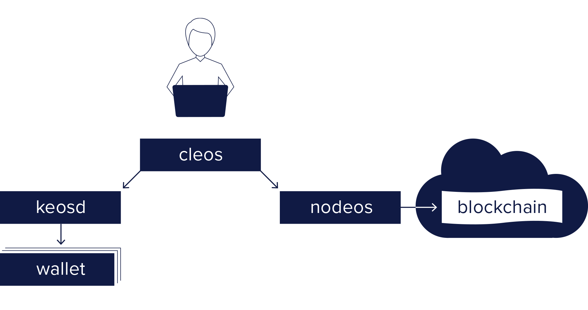

Humanity Pro is the human-first blockchain platform for creating and deploying smart contracts and distributed applications, built by Tetra Grids on the Spring 2.0 (Antelope) core. Humanity Pro comes with a number of programs. The primary ones included in Humanity Pro are the following:

* [Humanityd](01_humanityd/index.md) - Core service daemon that runs a node for block production, API endpoints, or local development.
* [Humanity](02_humanity/index.md) - Command line interface to interact with the blockchain (via `humanityd`) and manage wallets (via `humanity-keyd`).
* [humanity-keyd](03_humanity-keyd/index.md) - Component that manages Humanity Pro keys in wallets and provides a secure enclave for digital signing.

The basic relationship between these components is illustrated in the diagram below.

Additional Humanity Pro Resources:
* [Humanity Utilities](10_utilities/index.md) - Utilities that complement Humanity Pro software.

[//]: # (THIS IS A COMMENT REMOVING BROKEN LINKS)
[//]: # (Upgrade-Guide-20_upgrade-guide/index.md-antelope-version/protocol-upgrade-guide.)
[//]: # (Release Notes 30_release-notes/index.md  - All release notes for this Humanity Pro version.)

[[info | What's Next?]]
| [Install Humanity Pro Software](00_install/index.md) before exploring the sections above.
